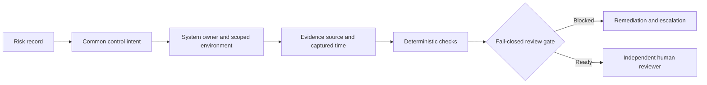

# OpenAI GRC role demonstration: common control mapping

**Independent synthetic example, not the OpenAI framework, a SOC 2 audit, or a claim of certification.**

The synthetic framework IDs intentionally begin with `SYN-`; actual SOC 2, ISO 27001 or other requirements must be supplied through a properly licensed, validated mapping and reviewed by qualified experts. Control reuse never eliminates framework-specific requirements or scope/ownership reassessment. Real integrations should provide least-privilege API access, scoped credentials, encrypted evidence storage, immutable event logs, retention rules, environment drift monitoring and secure remediation workflows.

**Reproduce:** `python portfolio_roles/openai_grc_controls/control_register.py`; tests `python -m unittest discover -s portfolio_roles/openai_grc_controls/tests -v`.

**Metrics before pilot:** time-to-gather-evidence, evidence rejection rate, orphan control rate, mis-scoping rate, control-owner hours, audit rework and manually verified material errors. No operational metrics have been measured.
